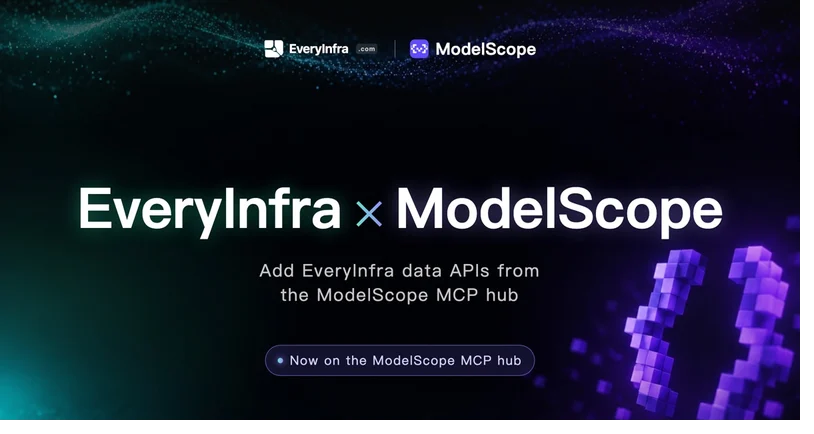
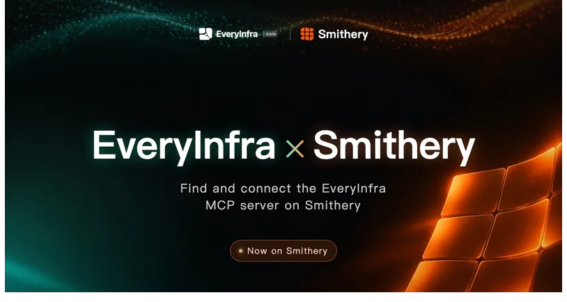
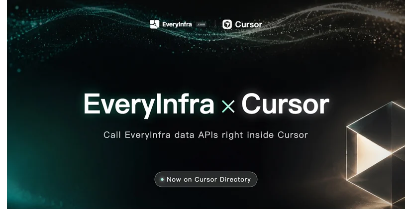
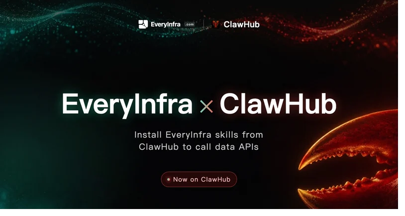
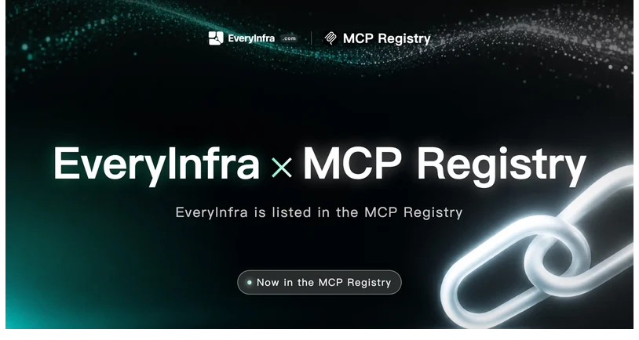
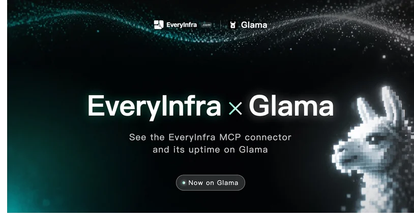
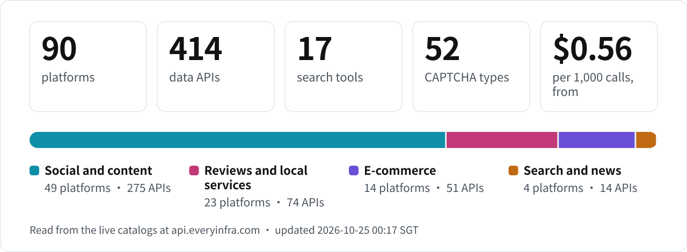

<!-- rq223-banner -->
<p align="center"></p>

<p>
  <picture>
    <source media="(prefers-color-scheme: dark)" srcset="assets/hero-dark.svg">
    <source media="(prefers-color-scheme: light)" srcset="assets/hero-light.svg">
    
  </picture>
</p>

**Data, web search, CAPTCHA solving and an OpenAI-compatible AI API for AI applications and agents. One API key, through REST, MCP or SDK. Pay per call; failed or empty calls are not charged.**

<a href="https://everyinfra.com/en/docs?utm_source=github&utm_medium=readme&utm_campaign=org-profile&utm_content=btn_get_key#quickstart"></a>
<a href="https://everyinfra.com/en/docs?utm_source=github&utm_medium=readme&utm_campaign=org-profile&utm_content=btn_docs"></a>
<a href="https://github.com/everyinfra/everyinfra-agent-plugins"></a>

```bash
claude mcp add --transport http everyinfra https://api.everyinfra.com/mcp \
  --header "Authorization: Bearer <API Key>"
```

<sub>Cursor, VS Code and Codex: one-click buttons in [everyinfra-agent-plugins](https://github.com/everyinfra/everyinfra-agent-plugins#quick-start).</sub>

⭐ **Star us on GitHub, get $1 in credit.** Star [everyinfra-agent-plugins](https://github.com/everyinfra/everyinfra-agent-plugins), then claim it in the [console](https://everyinfra.com/en/docs?utm_source=github&utm_medium=readme&utm_campaign=org-profile&utm_content=star_line#quickstart).

**English** · [简体中文](https://github.com/everyinfra/.github/blob/main/profile/README.zh-CN.md) · [Español](https://github.com/everyinfra/.github/blob/main/profile/README.es.md)

| Product | What you get |
| --- | --- |
| [Data](https://everyinfra.com/en/market?utm_source=github&utm_medium=readme&utm_campaign=org-profile&utm_content=table_data) | 414 capabilities across 90 platforms, from $0.56 per 1,000 calls |
| [Search](https://everyinfra.com/en/products/search?utm_source=github&utm_medium=readme&utm_campaign=org-profile&utm_content=table_search) | 17 web search tools with source links |
| [CAPTCHA](https://everyinfra.com/en/captcha?utm_source=github&utm_medium=readme&utm_campaign=org-profile&utm_content=table_captcha) | 52 challenge types |
| [AI](https://everyinfra.com/en/products/ai?utm_source=github&utm_medium=readme&utm_campaign=org-profile&utm_content=table_ai) | OpenAI-compatible chat completions, free after a top-up |

<!-- rq223-listed -->
<picture>
  <source media="(prefers-color-scheme: dark)" srcset="assets/listed-en-dark.jpg">
  <source media="(prefers-color-scheme: light)" srcset="assets/listed-en-light.jpg">
  
</picture>

<p align="center"><a href="https://modelscope.cn/mcp/servers/xiaoyuaimaomao/EveryInfra"></a><a href="https://smithery.ai/servers/everyinfra/api"></a><a href="https://cursor.directory/plugins/everyinfra-tiktok-instagram-amazon-data"></a><a href="https://clawhub.ai/skills/everyinfra"></a><a href="https://registry.modelcontextprotocol.io/v0/servers?search=everyinfra"></a><a href="https://glama.ai/mcp/connectors/io.github.xiaoxihexiaoyu/everyinfra"></a><a href="https://integrations.sh/everyinfra.com"></a></p>

## Live numbers and activity

<!-- readme-stats: charts are regenerated daily, do not edit by hand -->

Both charts are regenerated every day: the first from the live catalogs, the second from the git history of all EveryInfra repositories, including the private gateway (counts only). Each chart prints its update time.

<picture>
  <source media="(prefers-color-scheme: dark)" srcset="assets/readme-stats/coverage-en-dark.svg">
  <source media="(prefers-color-scheme: light)" srcset="assets/readme-stats/coverage-en-light.svg">
  
</picture>

<picture>
  <source media="(prefers-color-scheme: dark)" srcset="assets/readme-stats/activity-en-dark.svg">
  <source media="(prefers-color-scheme: light)" srcset="assets/readme-stats/activity-en-light.svg">
  
</picture>

## Team

<picture>
  <source media="(prefers-color-scheme: dark)" srcset="assets/team-dark.svg">
  <source media="(prefers-color-scheme: light)" srcset="assets/team-light.svg">
  
</picture>

<details>
<summary><b>SDK releases and open-source tools</b></summary>

- [EveryInfra SDK v0.2.1](https://github.com/everyinfra/everyinfra-agent-plugins/releases/tag/v0.2.1): Python wheel and Node package with SHA-256 checksums, installable from the GitHub release.
- Standalone skills: [Router](https://github.com/everyinfra/everyinfra-router-plugin) · [EveryData](https://github.com/everyinfra/everydata-plugin) · [EverySearch](https://github.com/everyinfra/everysearch-plugin) · [EveryAI](https://github.com/everyinfra/everyai-plugin) · [EverySolve](https://github.com/everyinfra/everysolve-plugin) · [EveryMail](https://github.com/everyinfra/everymail-plugin) · [EveryNumber](https://github.com/everyinfra/everynumber-plugin) · [EveryProxy](https://github.com/everyinfra/everyproxy-plugin) · [Research](https://github.com/everyinfra/everyinfra-research-plugin) · [Data Export](https://github.com/everyinfra/everyinfra-data-export-plugin)

</details>

[Website](https://everyinfra.com/en?utm_source=github&utm_medium=readme&utm_campaign=org-profile&utm_content=footer_site) · [ Discord](https://discord.gg/9f6KmfekZC) · [ Telegram: Everyinfra bot](https://t.me/everyinfra_bot) · [Terms](https://everyinfra.com/terms) · [Privacy](https://everyinfra.com/privacy)
