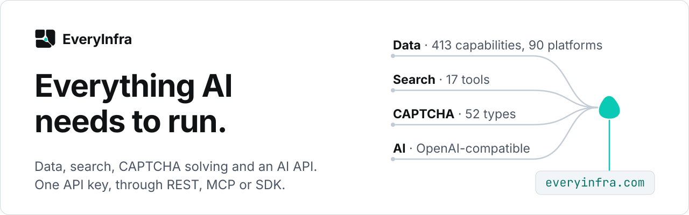
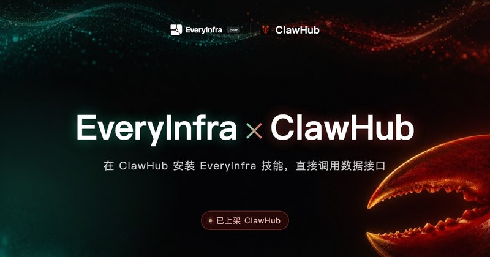

<!-- rq223-banner -->
<p align="center"></p>

<p>
  <picture>
    <source media="(prefers-color-scheme: dark)" srcset="assets/hero-dark.svg">
    <source media="(prefers-color-scheme: light)" srcset="assets/hero-light.svg">
    
  </picture>
</p>

**给 AI 应用和 Agent 的数据、网页搜索、验证码识别和  OpenAI 兼容 AI 接口。一个 API Key，走 REST、MCP 或 SDK 都行。按次计费，失败和空结果不扣费。**

<a href="https://everyinfra.com/docs?utm_source=github&utm_medium=readme&utm_campaign=org-profile&utm_content=btn_get_key_zh#quickstart"></a>
<a href="https://everyinfra.com/docs?utm_source=github&utm_medium=readme&utm_campaign=org-profile&utm_content=btn_docs_zh"></a>
<a href="https://github.com/everyinfra/everyinfra-agent-plugins/blob/main/i18n/README.zh-CN.md"></a>

```bash
claude mcp add --transport http everyinfra https://api.everyinfra.com/mcp \
  --header "Authorization: Bearer <API Key>"
```

<sub>Cursor、VS Code 和 Codex 的一键安装按钮在 [everyinfra-agent-plugins](https://github.com/everyinfra/everyinfra-agent-plugins/blob/main/i18n/README.zh-CN.md)。在中国大陆，可以把地址换成 `https://api-cn.everyinfra.com/mcp`。</sub>

⭐ **在 GitHub 点星领 $1 额度。** 给 [everyinfra-agent-plugins](https://github.com/everyinfra/everyinfra-agent-plugins) 点星，再到[控制台](https://everyinfra.com/docs?utm_source=github&utm_medium=readme&utm_campaign=org-profile&utm_content=star_line_zh#quickstart)「余额与充值」领取。

[English](https://github.com/everyinfra) · **简体中文** · [Español](https://github.com/everyinfra/.github/blob/main/profile/README.es.md)

| 产品 | 能做什么 |
| --- | --- |
| [数据](https://everyinfra.com/market?utm_source=github&utm_medium=readme&utm_campaign=org-profile&utm_content=table_data_zh) | 90 个平台 414 项能力，每千次 $0.56 起 |
| [搜索](https://everyinfra.com/products/search?utm_source=github&utm_medium=readme&utm_campaign=org-profile&utm_content=table_search_zh) | 17 个网页搜索工具，结果带来源链接 |
| [验证码](https://everyinfra.com/captcha?utm_source=github&utm_medium=readme&utm_campaign=org-profile&utm_content=table_captcha_zh) | 52 种验证码类型 |
| [AI](https://everyinfra.com/products/ai?utm_source=github&utm_medium=readme&utm_campaign=org-profile&utm_content=table_ai_zh) |  OpenAI 兼容的对话接口，充值后免费用 |

<!-- rq223-listed -->
## 已上架 7 家平台

<picture>
  <source media="(prefers-color-scheme: dark)" srcset="assets/listed-zh-dark.jpg">
  <source media="(prefers-color-scheme: light)" srcset="assets/listed-zh-light.jpg">
  
</picture>

<p align="center">
  <a href="https://modelscope.cn/mcp/servers/xiaoyuaimaomao/EveryInfra"></a>
  <a href="https://smithery.ai/servers/everyinfra/api"></a>
  <a href="https://cursor.directory/plugins/everyinfra-tiktok-instagram-amazon-data"></a>
  <a href="https://clawhub.ai/skills/everyinfra"></a>
  <a href="https://registry.modelcontextprotocol.io/v0/servers?search=everyinfra"></a>
  <a href="https://glama.ai/mcp/connectors/io.github.xiaoxihexiaoyu/everyinfra"></a>
  <a href="https://integrations.sh/everyinfra.com"></a>
</p>

## 实时数字与活跃度

<!-- readme-stats: charts are regenerated daily, do not edit by hand -->

两张图每天重新生成：第一张读线上目录，第二张读 EveryInfra 全部仓库（含未公开的网关仓，只统计数量）的 git 记录。图上写着更新时间。

<picture>
  <source media="(prefers-color-scheme: dark)" srcset="assets/readme-stats/coverage-zh-dark.svg">
  <source media="(prefers-color-scheme: light)" srcset="assets/readme-stats/coverage-zh-light.svg">
  
</picture>

<picture>
  <source media="(prefers-color-scheme: dark)" srcset="assets/readme-stats/activity-zh-dark.svg">
  <source media="(prefers-color-scheme: light)" srcset="assets/readme-stats/activity-zh-light.svg">
  
</picture>

## 团队

<picture>
  <source media="(prefers-color-scheme: dark)" srcset="assets/team-dark.svg">
  <source media="(prefers-color-scheme: light)" srcset="assets/team-light.svg">
  
</picture>

<details>
<summary><b>SDK 发布与开源工具</b></summary>

- [EveryInfra SDK v0.2.1](https://github.com/everyinfra/everyinfra-agent-plugins/releases/tag/v0.2.1)：Python wheel 和 Node 包，附 SHA-256 校验值，直接从 GitHub Release 安装。
- 独立 Skill：[Router](https://github.com/everyinfra/everyinfra-router-plugin) · [EveryData](https://github.com/everyinfra/everydata-plugin) · [EverySearch](https://github.com/everyinfra/everysearch-plugin) · [EveryAI](https://github.com/everyinfra/everyai-plugin) · [EverySolve](https://github.com/everyinfra/everysolve-plugin) · [EveryMail](https://github.com/everyinfra/everymail-plugin) · [EveryNumber](https://github.com/everyinfra/everynumber-plugin) · [EveryProxy](https://github.com/everyinfra/everyproxy-plugin) · [Research](https://github.com/everyinfra/everyinfra-research-plugin) · [Data Export](https://github.com/everyinfra/everyinfra-data-export-plugin)

</details>

[官网](https://everyinfra.com/?utm_source=github&utm_medium=readme&utm_campaign=org-profile&utm_content=footer_site_zh) · [ Discord](https://discord.gg/9f6KmfekZC) · [ Telegram：Everyinfra bot](https://t.me/everyinfra_bot) · [条款](https://everyinfra.com/terms) · [隐私](https://everyinfra.com/privacy)
